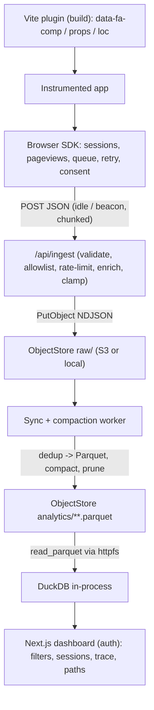

# FiberAnalytics

> Component-aware, zero-manual-instrumentation UI analytics framework with session-journey tracing.

FiberAnalytics captures _semantic_ UI context (which component was interacted with, and its safe primitive props) automatically at build time, ships a small non-blocking browser tracker with stable cookieless sessions and SPA pageview tracking, ingests events through a hardened serverless-style edge route, compiles them into hive-partitioned Parquet with a standalone worker, and queries them in-process with DuckDB — no always-on database, no cookies, no PII.

Storage is pluggable: local dev uses the filesystem (`data/`), while production uses any S3-compatible object store (AWS S3 or MinIO) — selected with a single `FA_STORAGE` env var. The same hive-partition layout is used everywhere.

## Architecture



| Module | Package | Role |
| --- | --- | --- |
| Compiler plugin | `@fiber-analytics/vite-plugin` | Babel AST transform that auto-tags interactive JSX with `data-fa-comp` / `data-fa-props` / `data-fa-loc`. |
| Client SDK | `@fiber-analytics/browser` | Delegated event tracker with sessions, SPA pageviews, consent, and a retrying/chunked transport. |
| Shared core | `@fiber-analytics/core` | Versioned event schema, validation, prop safelist + denylist, shared types. |
| Object storage | `@fiber-analytics/storage` | `ObjectStore` abstraction with local-filesystem and S3/MinIO adapters. |
| Demo app | `apps/demo` | Vite + React app exercising clicks, forms, modals, and client-side routing. |
| Edge + dashboard | `apps/dashboard` | Hardened Next.js ingestion route + authenticated analytics & tracing UI. |
| Sync worker | `apps/worker` | Standalone service: raw NDJSON → deduped Parquet, compaction, retention pruning. |

## Prerequisites

- Node.js >= 20 (tested on 22)
- pnpm >= 10 (`corepack enable` or `npm i -g pnpm`)

## Getting started

```bash
pnpm install
pnpm build:packages        # build core, storage, vite-plugin, browser SDK
pnpm dev                   # runs demo (5173) + dashboard (3000) together
```

Then:

1. Open the demo at http://localhost:5173 and click around (buttons, the form, open/close the modal). The on-screen overlay shows captured events live.
2. Flush buffered raw events into Parquet partitions:

   ```bash
   pnpm sync
   ```

3. Open the dashboard at http://localhost:3000 for the overview (top components, event-type breakdown, funnel), the **Sessions** list, a per-session **journey timeline** (`/sessions/[id]`), and **path analysis** (`/paths`). Use the filter bar to slice by date range, domain, event type, component, or URL.

### Environment

All configuration is via environment variables; see [`.env.example`](.env.example) for the full list with defaults. Everything is optional for local dev. The most common knobs:

```bash
FA_STORAGE=local                 # local (default) | s3
FA_DAILY_SECRET=change-me        # session-hash secret (rotate per deploy)
FA_DASHBOARD_PASSWORD=change-me  # enables dashboard auth when set
```

Copy `.env.example` to `apps/dashboard/.env.local` (for `pnpm dev`) or to `.env` (for docker-compose).

## Deployment

### Full local cloud-like stack (MinIO + worker + dashboard)

```bash
cp .env.example .env
docker compose up --build
```

This starts MinIO (S3, console at http://localhost:9001), the dashboard + ingestion edge (http://localhost:3000), and the sync worker — all wired to `FA_STORAGE=s3`.

### Vercel (dashboard) + a worker host

- Deploy `apps/dashboard` to Vercel; [`apps/dashboard/vercel.json`](apps/dashboard/vercel.json) sets the monorepo build/install commands. Configure `FA_STORAGE=s3` and the `FA_S3_*` / auth / secret env vars in the project settings.
- Run the worker anywhere that can reach the same bucket (container host, ECS, a cron box) using [`apps/worker/Dockerfile`](apps/worker/Dockerfile). It owns all Parquet compaction and retention pruning.

### CI

[`.github/workflows/ci.yml`](.github/workflows/ci.yml) runs lint + typecheck + build + test on every push and PR.

## Code quality

The codebase follows the `vercel-react-best-practices` rules where they apply:

- **Browser SDK** — init-once listeners (`advanced-init-once`), a single delegated `click`/`change` listener (`client-event-listeners`), passive listeners (`client-passive-event-listeners`), idle-time flushing (`js-request-idle-callback`), `Set`/`Map` lookups and early exits (`js-set-map-lookups`, `js-early-exit`), and a transient queue held in module state rather than React state.
- **Dashboard** — async Server Components, parallel DuckDB queries via `Promise.all` (`async-parallel`), per-request dedup with `React.cache()` (`server-cache-react`), a module-hoisted DuckDB connection (`server-hoist-static-io`), `<Suspense>` streaming per panel (`async-suspense-boundaries`), and `recharts` lazy-loaded via `next/dynamic` (`bundle-dynamic-imports`).
- **Vite plugin** — hoisted matchers (`js-hoist-regexp`), early exits on non-interactive nodes (`js-early-exit`), and idempotent transforms.
- **Architecture** — one responsibility per file, a single `src/index.ts` entry per package, shared types only in `@fiber-analytics/core`, and strict TypeScript across the workspace.

## Data schema (v2)

Each telemetry record is normalized into a columnar-friendly shape. `schema_version` lets old and new Parquet coexist (`union_by_name`) during rollout.

| Column | Type | Description |
| --- | --- | --- |
| `event_id` | UUID | Unique id for the record (used for dedup). |
| `schema_version` | INT | Event schema version. |
| `session_id` | VARCHAR | Primary journey key — ephemeral, cookieless, client-minted. |
| `pageview_id` | VARCHAR | Identifies a single page view within a session. |
| `seq` | BIGINT | Monotonic per-session ordering counter. |
| `session_hash` | VARCHAR | Secondary server-side correlation key (bot/cross-check). |
| `timestamp` | TIMESTAMP | Server-authoritative receive time (clamped). |
| `occurred_at` | TIMESTAMP | Client event time. |
| `event_type` | VARCHAR | `click`, `view`, `page_view`, `submit`, `input`, `state_change`, `custom`. |
| `component_name` | VARCHAR | Extracted UI component identifier. |
| `properties` | JSON | Safelisted primitive props / metadata (sensitive keys redacted). |
| `url_path` | VARCHAR | Path where the action occurred. |
| `referrer`, `page_title` | VARCHAR | Page context. |
| `viewport_w`, `viewport_h` | INT | Viewport dimensions. |
| `locale`, `device` | VARCHAR | Locale and device class hint. |
| `utm_*` | VARCHAR | Optional campaign parameters. |
| `source_loc` | VARCHAR | `file:line:col` of the component (trace-to-source). |

## Privacy

Journeys are keyed on a **client `session_id`**: an ephemeral, cookieless id held in `sessionStorage` with a 30-minute sliding inactivity window — no cross-site identifier and no PII. A server-derived `session_hash` is kept only as a secondary correlation/bot-check signal:

```
session_hash = sha256(userAgent + truncatedIP + dailySecret)
```

IPv4 is truncated to /24 and IPv6 to /48, and the secret rotates per UTC day — so it cannot be correlated across days. The SDK honours **DNT/GPC** and an explicit consent gate, sensitive property keys are redacted at both build and ingest time, and the worker **prunes** partitions older than `FA_RETENTION_DAYS`.

## Scripts

| Command | Description |
| --- | --- |
| `pnpm build:packages` | Build the shared packages (`core`, `storage`, `vite-plugin`, `browser`). |
| `pnpm dev` | Run demo + dashboard concurrently. |
| `pnpm sync` | Run the worker once: compile raw NDJSON into Parquet partitions. |
| `pnpm worker` | Run the worker as a long-lived service (poll + compact + prune). |
| `pnpm build` | Build packages + dashboard for production. |
| `pnpm test` | Run all workspace tests (Vitest). |
| `pnpm lint` / `pnpm format` | Lint / format the workspace. |

## Troubleshooting

### `pnpm` fails with `value.replace is not a function`

This is caused by your global `~/.npmrc`, not by this project. pnpm cannot parse a **registry-scoped** CA entry written with array syntax, e.g.:

```
//your-registry/:ca[]=${CERT1}
```

pnpm runs an env-substitution pass that calls `.replace()` on each value; for a scoped `…/:ca[]=` key the value is an array, so it throws. (Global `ca[]=` PEM lines are fine; only the scoped `:ca[]=` form breaks it.)

Permanent fix - remove just those scoped lines (a backup is cheap):

```bash
cp ~/.npmrc ~/.npmrc.bak
sed -i '' '/:ca\[\]=/d' ~/.npmrc   # macOS; use `sed -i '/:ca\[\]=/d' ~/.npmrc` on Linux
```

If you genuinely need a per-registry CA, use a file reference instead of the inline array:

```
//your-registry/:cafile=/absolute/path/to/ca.pem
```

Temporary, non-invasive alternative (per-command, bypasses your global config and its auth):

```bash
printf 'registry=https://registry.npmjs.org/\n' > /tmp/clean.npmrc
npm_config_userconfig=/tmp/clean.npmrc pnpm install
```

## License

MIT
