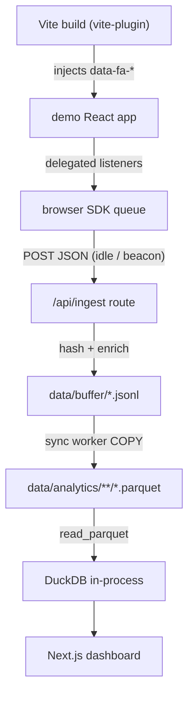

# FiberAnalytics

> Component-aware, zero-manual-instrumentation UI analytics framework — **local-first scaffold**.

FiberAnalytics captures _semantic_ UI context (which component was interacted with, and its safe primitive props) automatically at build time, ships a sub-5KB non-blocking browser tracker, ingests events through a serverless-style edge route, and queries cold Parquet files in-process with DuckDB — no always-on database, no cookies, no PII.

This repository is a **fully local end-to-end scaffold**: cloud object storage (S3) is emulated by the `data/` directory and DuckDB runs in-process. The hive-partition layout matches the production design, so swapping in real S3 later is just a path change.

## Architecture



| Module | Package | Role |
| --- | --- | --- |
| Compiler plugin | `@fiber-analytics/vite-plugin` | Babel AST transform that auto-tags interactive JSX with `data-fa-comp` / `data-fa-props`. |
| Client SDK | `@fiber-analytics/browser` | Sub-5KB delegated event tracker + idle/beacon batch queue. |
| Shared core | `@fiber-analytics/core` | Event schema, constants, prop safelist, shared types. |
| Demo app | `apps/demo` | Vite + React app exercising clicks, forms, and a modal. |
| Edge + dashboard | `apps/dashboard` | Next.js ingestion route, DuckDB sync worker, and analytics UI. |

## Prerequisites

- Node.js >= 20 (tested on 22)
- pnpm >= 10 (`corepack enable` or `npm i -g pnpm`)

## Getting started

```bash
pnpm install
pnpm build:packages        # build core, vite-plugin, browser SDK
pnpm dev                   # runs demo (5173) + dashboard (3000) together
```

Then:

1. Open the demo at http://localhost:5173 and click around (buttons, the form, open/close the modal). The on-screen overlay shows captured events live.
2. Flush buffered raw events into Parquet partitions:

   ```bash
   pnpm sync
   ```

3. Open the dashboard at http://localhost:3000 to see top components, an event-type breakdown, a funnel, and recent paths.

### Environment

Create `apps/dashboard/.env.local` (optional) to set the daily session-hash secret:

```bash
FA_DAILY_SECRET=change-me
```

If unset, a built-in development default is used.

## Code quality

The codebase follows the `vercel-react-best-practices` rules where they apply:

- **Browser SDK** — init-once listeners (`advanced-init-once`), a single delegated `click`/`change` listener (`client-event-listeners`), passive listeners (`client-passive-event-listeners`), idle-time flushing (`js-request-idle-callback`), `Set`/`Map` lookups and early exits (`js-set-map-lookups`, `js-early-exit`), and a transient queue held in module state rather than React state.
- **Dashboard** — async Server Components, parallel DuckDB queries via `Promise.all` (`async-parallel`), per-request dedup with `React.cache()` (`server-cache-react`), a module-hoisted DuckDB connection (`server-hoist-static-io`), `<Suspense>` streaming per panel (`async-suspense-boundaries`), and `recharts` lazy-loaded via `next/dynamic` (`bundle-dynamic-imports`).
- **Vite plugin** — hoisted matchers (`js-hoist-regexp`), early exits on non-interactive nodes (`js-early-exit`), and idempotent transforms.
- **Architecture** — one responsibility per file, a single `src/index.ts` entry per package, shared types only in `@fiber-analytics/core`, and strict TypeScript across the workspace.

## Data schema

Each telemetry record is normalized into a columnar-friendly shape:

| Column | Type | Description |
| --- | --- | --- |
| `event_id` | UUID | Unique id for the record. |
| `session_hash` | VARCHAR | Ephemeral 24h cryptographic session id. |
| `timestamp` | TIMESTAMP | ISO 8601 UTC event time. |
| `event_type` | VARCHAR | `click`, `view`, or `state_change`. |
| `component_name` | VARCHAR | Extracted UI component identifier. |
| `properties` | JSON | Safelisted primitive props / metadata. |
| `url_path` | VARCHAR | Relative path where the action occurred. |

## Privacy

Session stitching is cookie-less and ephemeral:

```
session_hash = sha256(userAgent + truncatedIP + dailySecret)
```

IPv4 is truncated to /24 and IPv6 to /48, and the secret rotates per UTC day — so sessions cannot be correlated across days and no PII is stored.

## Scripts

| Command | Description |
| --- | --- |
| `pnpm build:packages` | Build the three shared packages. |
| `pnpm dev` | Run demo + dashboard concurrently. |
| `pnpm sync` | Compile buffered JSONL into Parquet partitions. |
| `pnpm build` | Build packages + dashboard for production. |
| `pnpm test` | Run package tests. |
| `pnpm lint` / `pnpm format` | Lint / format the workspace. |

## Troubleshooting

### `pnpm` fails with `value.replace is not a function`

This is caused by your global `~/.npmrc`, not by this project. pnpm cannot parse a **registry-scoped** CA entry written with array syntax, e.g.:

```
//your-registry/:ca[]=${CERT1}
```

pnpm runs an env-substitution pass that calls `.replace()` on each value; for a scoped `…/:ca[]=` key the value is an array, so it throws. (Global `ca[]=` PEM lines are fine; only the scoped `:ca[]=` form breaks it.)

Permanent fix - remove just those scoped lines (a backup is cheap):

```bash
cp ~/.npmrc ~/.npmrc.bak
sed -i '' '/:ca\[\]=/d' ~/.npmrc   # macOS; use `sed -i '/:ca\[\]=/d' ~/.npmrc` on Linux
```

If you genuinely need a per-registry CA, use a file reference instead of the inline array:

```
//your-registry/:cafile=/absolute/path/to/ca.pem
```

Temporary, non-invasive alternative (per-command, bypasses your global config and its auth):

```bash
printf 'registry=https://registry.npmjs.org/\n' > /tmp/clean.npmrc
npm_config_userconfig=/tmp/clean.npmrc pnpm install
```

## License

MIT
