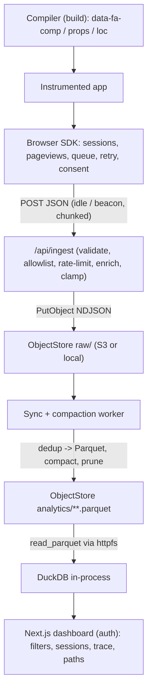

# Architecture

> How FiberAnalytics is split into modules, how data flows between them, and who owns the schema.

## Data flow



### What each arrow means

1. **Build -> App** — The compiler (Babel transform, exposed via Vite/webpack/Rollup/esbuild/Babel adapters) injects `data-fa-comp`, `data-fa-props`, and (optionally) `data-fa-loc` onto every interactive element. For Vite it runs with `enforce: 'pre'` before `@vitejs/plugin-react` compiles JSX away. See [Compiler — Vite](integration-vite.md) and [Compiler — Next.js](integration-nextjs.md).
2. **App -> SDK** — The browser SDK attaches a single set of delegated listeners (`click`, `submit`, `change`, debounced `input`, `keydown` for `role="button"`). It reads the `data-fa-*` attributes via `element.closest('[data-fa-comp]')`, enriches the event with session/pageview ordering and page context, and buffers it.
3. **SDK -> Ingest** — Delivery is via `requestIdleCallback`-scheduled `fetch` during idle time, or chunked `navigator.sendBeacon` on page hide. Payloads are JSON `{ domain, events }` chunked to stay under the ~60 KB beacon ceiling; failed batches spill to `localStorage` and are retried on next init.
4. **Ingest -> Raw** — `apps/dashboard/app/api/ingest/route.ts` validates the payload, checks origin/domain allowlists, applies bot filtering and per-IP rate limiting, clamps timestamps, derives `session_hash`, and writes one NDJSON object per request under `raw/`. The edge is serverless-safe (writes to the object store, never local disk).
5. **Raw -> Worker** — `apps/worker` claims `raw/*.ndjson` into `processing/` (with orphan recovery), deduplicates by `event_id`, and writes hive-partitioned Parquet (`analytics/domain=<domain>/year=YYYY/month=MM/day=DD/*.parquet`). Source objects are deleted only after a successful write.
6. **Worker -> Analytics** — Periodic compaction merges small files within a partition once the file count exceeds `FA_COMPACTION_THRESHOLD` (default 8), re-deduping by `event_id`. Retention pruning deletes partitions older than `FA_RETENTION_DAYS`.
7. **Analytics -> DuckDB** — The dashboard opens a single module-hoisted in-process DuckDB connection (`apps/dashboard/lib/duckdb.ts`). For S3 it issues `httpfs` setup via `ObjectStore.duckdbSetup()`. Queries use `read_parquet(..., hive_partitioning = true, union_by_name = true)`.
8. **DuckDB -> Dashboard** — Next.js Server Components issue parallel DuckDB queries (`Promise.all`) behind `<Suspense>` streaming. Filters (date range, domain, event type, component, URL) compile to parameterized SQL.

## Modules

| Module          | Package / path                  | Responsibility                                                                                                            |
| --------------- | ------------------------------- | ------------------------------------------------------------------------------------------------------------------------- |
| Compiler        | `packages/compiler`             | Babel AST transform that auto-tags interactive JSX with `data-fa-comp` / `data-fa-props` / `data-fa-loc` (Vite, webpack/Next.js, Rollup, esbuild, Babel adapters). |
| Client SDK      | `packages/browser`              | Delegated tracker: sessions, SPA pageviews, consent gating, idle-queue + retrying transport, localhost overlay.           |
| Shared core     | `packages/core`                 | Versioned event schema (`AnalyticsEvent`), validation, `safelistProps` / `isSensitiveKey`, shared constants and types.    |
| Object storage  | `packages/storage`              | `ObjectStore` abstraction with `LocalObjectStore` and `S3ObjectStore` adapters, plus `duckdbSetup()` SQL.                 |
| Ingestion edge  | `apps/dashboard/app/api/ingest` | Hardened `POST` handler: allowlists, bot filter, rate limit, body caps, content-type check, enrichment.                   |
| Dashboard       | `apps/dashboard`                | Next.js authenticated UI: overview, sessions, per-session timeline (`/sessions/[id]`), path analysis (`/paths`), filters. |
| Sync worker     | `apps/worker`                   | Claim -> compile -> compact -> prune pipeline; runs one-shot (`pnpm sync`) or as a polling service.                       |
| Demo app        | `apps/demo`                     | Vite + React app exercising clicks, forms, modals, and client-side routing; ships events to the local edge.               |

### Ownership notes

- `packages/compiler` and `packages/browser` share no runtime dependency — they communicate only through the `data-fa-*` HTML attributes emitted at build and read at capture time.
- `packages/core` has no dependency on any other workspace package. Every other package may depend on `core`.
- `packages/storage` exposes `createObjectStoreFromEnv(env, defaultRoot)` which selects the local or S3 adapter based on `FA_STORAGE`. Both `apps/dashboard` and `apps/worker` call it, but the worker owns all Parquet writes.
- The dashboard never writes Parquet; it only reads it. The worker never serves HTTP (unless `FA_WORKER_HEALTH_PORT` is set).

## Schema source of truth

`packages/core/src/schema.ts` is the **single source of truth** for the event schema.

- `SCHEMA_VERSION` — bumped when the persisted shape changes.
- `AnalyticsEvent` / `ClientEvent` — TypeScript interfaces that define every stored column.
- `EVENT_COLUMNS` — ordered column list used when projecting rows into Parquet (`apps/worker/src/duck.ts:SELECT_COLUMNS` is derived from it).

The dashboard's `CANONICAL_COLUMNS` in `apps/dashboard/lib/duckdb.ts` **must be regenerated** from `EVENT_COLUMNS` plus the hive partition columns (`domain`, `year`, `month`, `day`). Whenever `EVENT_COLUMNS` changes, update `CANONICAL_COLUMNS` to match; the dashboard's `eventsSource()` helper synthesizes missing columns as typed `NULL`s so old Parquet remains queryable via `union_by_name`.

> **Note (step 23):** `event_name` was added to `EVENT_COLUMNS` to support manual/custom events (`event_type === 'custom'`). Legacy Parquet without this column is handled by the dashboard's `NULL AS event_name` synthesis and by the worker's `union_by_name` reads — no backfill is required.

## Object-store layout

```
<FA_DATA_DIR or s3://<bucket>/<prefix>>/
  raw/<timestamp>-<uuid>.ndjson        # one file per ingest request
  processing/<timestamp>-<uuid>.ndjson # claimed but not yet compiled (crash-recovery)
  analytics/
    domain=<domain>/year=YYYY/month=MM/day=DD/<uuid>.parquet
```

Hive keys (`domain`, `year`, `month`, `day`) are extracted by DuckDB automatically when `hive_partitioning = true`.

## Related docs

- [Quickstart](quickstart.md) — run the stack locally end-to-end.
- [Compiler — Vite](integration-vite.md) — Vite adapter, plugin options and ignore attribute.
- [Compiler — Next.js](integration-nextjs.md) — Next.js adapter.
- [Browser SDK](integration-react.md) — init, consent, manual track/page, teardown.
- [Privacy](privacy.md) — session model, IP truncation, DNT/GPC, redaction, retention.
- [Deployment](deployment.md) — Vercel + worker hosts, MinIO local stack.
- [Production checklist](production-checklist.md) — hardening before going live.
- [Troubleshooting](troubleshooting.md) — empty globs, pnpm `ca[]` issue.
